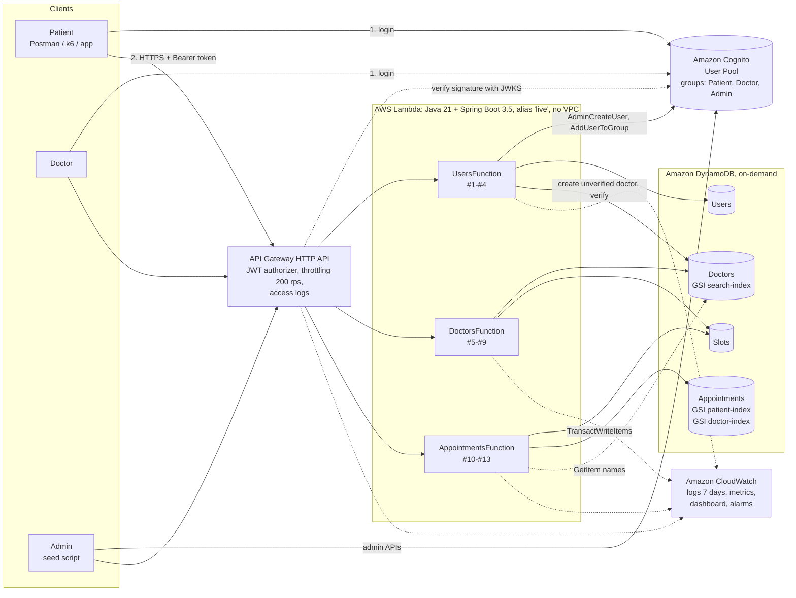
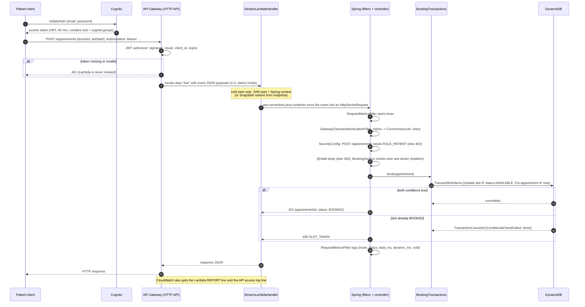
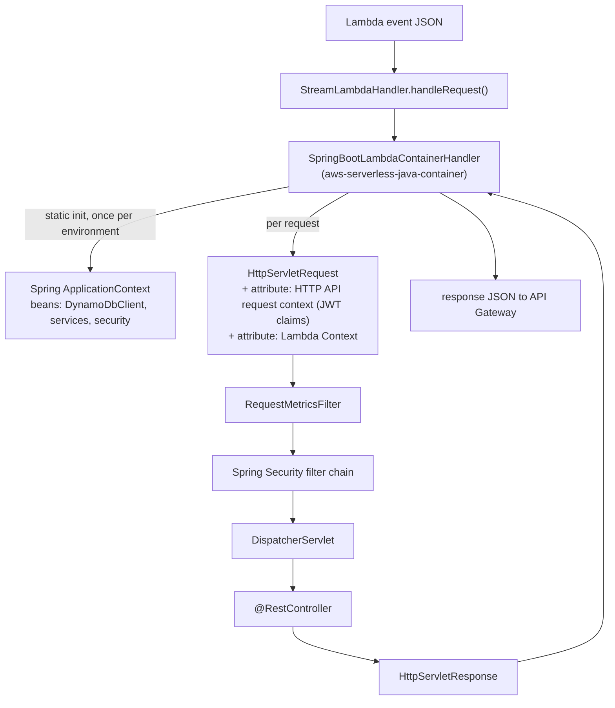

# Architecture

## 1. High-level view



Everything is created by one SAM template (`infra/template.yaml`) and removed by one `sam delete`.

## 2. How one request runs (booking)



## 3. Spring Boot inside Lambda



Key points:
- **No Tomcat.** Tomcat is excluded; the library acts as the servlet container. (`-Plocal` adds Tomcat for laptop runs.)
- The **static field** in `StreamLambdaHandler` starts Spring once per execution environment. That is the cold
  start. Warm requests reuse the context, the DynamoDB client and its HTTPS connections.
- **SnapStart:** when a version is published, Lambda runs that initialisation once and stores a snapshot.
  New environments *restore* the snapshot instead of starting Spring. **Priming** (`PRIMING_ENABLED=true`)
  sends one fake request through the whole stack inside the CRaC `beforeCheckpoint` hook, so lazy class
  loading and the DynamoDB connection are already done in the snapshot (`common/lambda/SnapStartPriming.java`).
- `JAVA_TOOL_OPTIONS=-XX:+TieredCompilation -XX:TieredStopAtLevel=1` shortens JVM start (C1 JIT only).

## 4. Authentication and authorisation

| Layer | What it checks | Where |
|---|---|---|
| Cognito | password, issues JWT with `sub` and `cognito:groups` | user pool + app client (template) |
| API Gateway JWT authorizer | signature (JWKS), issuer, audience/client_id, expiry → else **401** | `HttpApi.Auth` (template) |
| Spring Security | role per route → else **403** | `*/config/SecurityConfig.java` |
| Service code | ownership ("is this your appointment?") → **403**; doctor verified → else **404** | `AppointmentService`, `BookingService` |

Why the Lambda trusts the claims without re-checking the signature: from outside the account, only this API can
invoke the functions (the Lambda resource policy SAM creates names the API as the only source), and API Gateway has
already verified the token. Inside the account, only IAM users with `lambda:InvokeFunction` could send a forged
event, so keep IAM permissions tight. Re-verifying would
download keys during cold starts for no security gain. `GatewayClaimsAuthenticationFilter` documents this.

Why groups and not a "role" attribute: a user can edit some of their own attributes, but only an admin API
can put a user in a group. Registration puts the user in `Patient` or `Doctor` server-side. `Admin` can only be
granted with the Cognito admin API (seed script), and public Cognito sign-up is disabled (`AllowAdminCreateUserOnly`).

Doctors can self-register, so they start **unverified**: invisible in search, not bookable, until an admin
verifies them (Practo also lists "verified" doctors).

## 5. Data model (DynamoDB)

```mermaid
erDiagram
  USERS {
    string userId PK "Cognito sub"
    string email
    string name
    string phone
    string role "PATIENT | DOCTOR"
  }
  DOCTORS {
    string doctorId PK "= userId"
    string name
    string speciality
    string city
    number fee
    bool verified
    string searchCity "GSI search-index PK, only if verified"
    string specKey "GSI SK: speciality#name"
  }
  SLOTS {
    string doctorId PK
    string slotStart SK "UTC ISO-8601, 30-min grid"
    string status "AVAILABLE | BOOKED"
    string appointmentId "set while BOOKED"
  }
  APPOINTMENTS {
    string appointmentId PK "UUID"
    string patientId "GSI patient-index PK"
    string doctorId "GSI doctor-index PK"
    string slotStart "GSI SK in both"
    string status "BOOKED | CANCELLED | COMPLETED | NO_SHOW"
    string doctorName "copied for listings"
    string patientName
  }
  USERS ||--o| DOCTORS : "doctor account"
  DOCTORS ||--o{ SLOTS : publishes
  SLOTS ||--o{ APPOINTMENTS : "at most one active"
  USERS ||--o{ APPOINTMENTS : books
```

| Access pattern | Served by |
|---|---|
| Own profile | Users GetItem(userId) |
| Search verified doctors in a city (+ speciality, + name filter) | Doctors **search-index** Query(searchCity, begins_with(specKey)) |
| Doctor details | Doctors GetItem(doctorId) |
| Slots of a doctor in a range | Slots Query(doctorId, slotStart BETWEEN) |
| Book / cancel | TransactWriteItems on Slots + Appointments |
| Patient's appointments | Appointments **patient-index** Query(patientId, slotStart BETWEEN) |
| Doctor's received appointments | Appointments **doctor-index** Query(doctorId, slotStart BETWEEN) |

Design choices to explain:
- **Sparse index.** Only verified doctors have `searchCity`, so search needs no "verified" filter.
- **Fixed 30-minute grid.** Two slots overlap only if they start at the same time, which the conditional put
  `attribute_not_exists(slotStart)` rejects. No read-then-write race.
- **UTC keys** with fixed width sort correctly as strings; the API also returns IST for display.
- **Denormalised names** on appointments: list views need no extra reads.
- **GSIs are eventually consistent:** a new booking can take a moment to appear in `GET /appointments`.
- **Four tables, not single-table design:** easier to explain and to divide between members, and IAM is per table.
- **On-demand capacity** so experiments measure Lambda, not a tiny provisioned throughput.

## 6. Booking consistency

Invariant: *for every slot, at most one non-cancelled appointment refers to it, and the slot is BOOKED if and
only if that appointment exists.*

| Operation | Transaction items (all-or-nothing) | Failure → HTTP |
|---|---|---|
| Book | Update Slot `SET BOOKED, appointmentId` **IF** status = AVAILABLE; Put Appointment **IF** not exists | slot exists: 409 SLOT_TAKEN; no slot: 404; conflict: 409 CONFLICT_RETRY; throttled: 503 CAPACITY |
| Cancel | Update Slot `SET AVAILABLE REMOVE appointmentId` **IF** appointmentId = this; Update Appointment `SET CANCELLED` **IF** status = BOOKED | 409 NOT_CANCELLABLE |
| Complete / no-show | single conditional UpdateItem **IF** status = BOOKED AND doctorId = caller | 409 INVALID_TRANSITION |

Idempotent retries: with an `Idempotency-Key` header, the appointment id is `UUID(patient + key)`. A retry
fails the slot condition, but the cancellation reason contains the slot's current `appointmentId`; if that is our
own id, the earlier appointment is returned with **200** instead of a second booking.

## 7. Observability

| Source | Content | Used for |
|---|---|---|
| Lambda REPORT line | Duration, Billed Duration, Memory, Init Duration (cold) / Restore Duration (SnapStart) | E1, E5 |
| Our JSON line (`REQUEST_METRICS` logger) | route, status, total_ms, dynamo_ms, dynamo_calls, cold, function version | E2 breakdown |
| API access log | responseLatency, integrationLatency, status | gateway overhead |
| CloudWatch metrics | Invocations, ConcurrentExecutions, Throttles, Errors, API Count/4xx/5xx, DynamoDB consumed units | E3, E5 |
| Dashboard `practo-lite-dashboard` | all of the above on one screen | screenshots |
| Response headers (diagnostics on) | X-Cold-Start, X-Lambda-Request-Id, X-Function-Version | cold-start probe |

## 8. Practo vs prototype <a id="practo-vs-prototype"></a>

| Concern | Practo (reported in our sources) | Practo-Lite | Why different |
|---|---|---|---|
| Compute | ~80 services on self-managed Kubernetes (kOps) on EC2, ELB + NGINX routers | 3 Lambda functions (Spring Boot) | The course exercise; per-request billing; scales to zero |
| Self-service infrastructure | in-house DSL for RDS, Redis, etc. | one SAM template | same goal, much smaller scale |
| Idle capacity cost | per-service ASGs underused; 40%+ saving after consolidation (self-reported) | no idle compute; cost per 1,000 requests measured | ours can be measured; theirs cannot be checked |
| Database | RDS MySQL; slow generated SQL; I/O and temp-table bottlenecks; tuned ("5×", no benchmark given) | DynamoDB with keys from access patterns | no query planner, no temp tables |
| Background work | SQS + Spot workers + queue-based pod autoscaler | not built (future: SQS notifications) | not needed for the exercise |
| Logs and monitoring | S3 LB logs, Graylog, Sentry | CloudWatch Logs, metrics, dashboard | managed and enough |
| Demand spikes | COVID-19 growth: 3× (Mar-Nov 2020) and 500% (Mar-May 2020), from two different Practo datasets | spike profile in E3 | tests how serverless reacts to a surge |

## 9. Trade-offs we accept (say these in the viva)

- **Spring Boot makes cold starts heavier** than plain handlers (more classes to load). We accept it for the
  developer productivity and familiar structure, and measure it in E1, where SnapStart and priming are the mitigation.
- **Three functions:** fewer cold-start pools and simpler config than 13; clearer ownership than one.
- **Cognito admin APIs in registration** mean two systems without a shared transaction; we compensate
  (delete the Cognito user) when a later step fails (`UserService.register`).
- **DynamoDB search is limited:** city is required; name is a filter. Full-text search would need OpenSearch.
- **Single region**, no multi-AZ decisions to make (Lambda and DynamoDB are multi-AZ by default).
