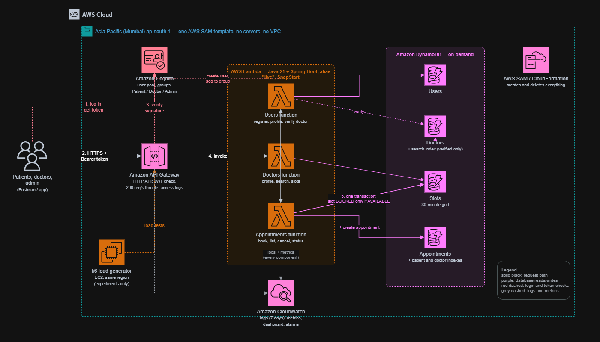

# Practo-Lite: a serverless doctor-booking platform on AWS

**IT457 Cloud Computing · Dhirubhai Ambani University · Group 13 · Autumn 2026**

Case study: *Practo connects 60 million patients to 200,000 doctors from 10,000 hospitals using AWS.*
Exercise theme: *Serverless and startups*: build a serverless API and measure cold start and cost per 1,000 requests.

Practo-Lite is a small, Practo-inspired booking system with both sides of the platform: patients search doctors and
book 30-minute slots, doctors publish profiles and slots, and an admin verifies doctors. It runs entirely on managed
AWS services (API Gateway, Lambda, DynamoDB, Cognito, CloudWatch), is deployed with one AWS SAM template, and was
used to measure cold starts, latency, scaling, double-booking safety and cost.

> This is **our prototype, not Practo's architecture.** Practo reports about 80 services on a self-managed Kubernetes
> cluster with RDS MySQL ([Docs/ARCHITECTURE.md](Docs/ARCHITECTURE.md)). We built the serverless alternative of its
> core transaction so that we could measure its trade-offs ourselves.

**Live API (ap-south-1):** `https://jui4tr4295.execute-api.ap-south-1.amazonaws.com`
Try it: `GET /doctors?city=Ahmedabad` (public, read-only).

---

## Contents
1. [Team](#1-team)
2. [Project status](#2-project-status)
3. [Architecture](#3-architecture)
4. [Repository structure](#4-repository-structure)
5. [API](#5-api)
6. [Build and test locally](#6-build-and-test-locally)
7. [Access AWS](#7-access-aws)
8. [Deploy](#8-deploy)
9. [Seed data and test with Postman](#9-seed-data-and-test-with-postman)
10. [Run the experiments](#10-run-the-experiments)
11. [Analyse results](#11-analyse-results)
12. [Cost control and cleanup](#12-cost-control-and-cleanup)
13. [Git workflow](#13-git-workflow)
14. [Limitations](#14-limitations)

---

## 1. Team

| Member | Roll No. | Slice | Experiments |
|---|---|---|---|
| **A: Jevik Bhalodia** | 202303021 | Users service (registration, profile, admin verification), security, Cognito, API Gateway, CloudWatch dashboard, SAM base template | E1 cold start, E5 cost |
| **B: Gautam Modi** | 202301214 | Doctors service (profiles, search, slots), request timing and logging, seed data, load-test scripts | E2 latency, E3 scaling |
| **C: Diya Patel** | 202301216 | Appointments service (booking, cancel, status), booking transaction, test tools (DynamoDB Local) | E4 double booking |

Every pull request was reviewed by another member. Code owners per folder are in [.github/CODEOWNERS](.github/CODEOWNERS).

## 2. Project status

| Part | Status |
|---|---|
| 13 core endpoints + 2 optional, 57 automated tests, CI on every PR | Done |
| Deployed to AWS (ap-south-1) with AWS SAM | Done, live |
| E1 cold start vs warm (SnapStart off / on / primed) | Done: `results/exp1-coldstart/` |
| E2 latency at 1, 2, 5, 8 users | Done: `results/exp2-latency/` |
| E3 scaling (ramp, spike, reserved-concurrency cap) | Done: `results/exp3-scaling/` |
| E4 concurrent booking (safe vs unsafe, cancel race) | Done: `results/exp4-race/` |
| E5 cost per 1,000 requests | **Not completed yet** (see below) |
| E6 memory size (512 / 1024 / 2048 MB) | **Not completed yet** (see below) |

**E5 and E6:** they were planned after the load experiments, which were delayed while we waited for AWS to raise the
account's Lambda concurrency limit (we requested 1,000; 400 was granted on 16 November 2026). With the 400 limit in place,
E5 and E6 will be completed before the next member's viva.

## 3. Architecture



*(Source: [Docs/diagrams/our_architecture.drawio](Docs/diagrams/our_architecture.drawio). Open it in draw.io.)*

| Component | Role |
|---|---|
| **Amazon Cognito** | Login. Users belong to one group, `Patient`, `Doctor` or `Admin`, which is their role. Only admin APIs can set groups. |
| **API Gateway (HTTP API)** | The public URL. Checks the Cognito token before any code runs (401 otherwise). Limits traffic to 200 req/s. Writes access logs. |
| **AWS Lambda ×3** | `users`, `doctors`, `appointments`. Each is a **Spring Boot 3.5** app (Java 21) running through [aws-serverless-java-container](https://github.com/aws/serverless-java-container), called through the alias `live`, with **SnapStart**. Spring Security checks the role (403 otherwise). |
| **Amazon DynamoDB ×4** | `Users`, `Doctors` (+ a search index containing only verified doctors), `Slots` (30-minute grid), `Appointments` (+ patient and doctor indexes). On-demand capacity. |
| **CloudWatch** | Logs (7 days), metrics, the `practo-lite-dashboard`, alarms. Every request also logs one JSON line with `total_ms`, `dynamo_ms` and `cold`. |
| **AWS SAM** | [infra/template.yaml](infra/template.yaml) creates and deletes everything. |

**No double booking.** A booking is one DynamoDB transaction: *mark the slot BOOKED only if it is still AVAILABLE*
plus *create the appointment*. Both happen or neither does. If 100 patients race for one slot, exactly one gets
`201` and the rest get `409 SLOT_TAKEN`. An unsafe "read, check, then write" mode exists **only** for the E4
comparison (`BookingMode=naive`).

More detail: [Docs/ARCHITECTURE.md](Docs/ARCHITECTURE.md). Practo's reported architecture:
[Docs/diagrams/practo_architecture.drawio](Docs/diagrams/practo_architecture.drawio). Case study reports: `Docs/`.

## 4. Repository structure

```
├── pom.xml                      Maven parent: Java 21, Spring Boot 3.5, AWS SDK v2 BOM
├── common/                      shared code: security (JWT claims -> roles), errors, DynamoDB client,
│                                request metrics, SnapStart priming, Lambda handler factory
├── users-service/               UsersFunction         endpoints 1-4      (A)
├── doctors-service/             DoctorsFunction       endpoints 5-9      (B)
├── appointments-service/        AppointmentsFunction  endpoints 10-13    (C)
├── test-support/                embedded DynamoDB Local + API Gateway event builder (tests only)
├── build-support/               Maven assembly: Lambda zip = classes + lib/*.jar
├── infra/template.yaml          AWS SAM template (Cognito, HTTP API, 3 Lambdas, 4 tables, dashboard, alarms)
├── infra/samconfig.toml         deploy settings: shared stack + optional personal stacks
├── scripts/                     seed, reset, consistency check, cold-start probe, CloudWatch export, cost calculator
├── load-tests/k6/               latency.js (E2), scaling.js (E3), race.js + cancel_race.js (E4)
├── analysis/charts.py           results/ -> summary CSVs and PNG charts
├── experiments/prices.json      AWS prices for E5, filled from the official pricing pages (never guessed)
├── results/                     raw experiment data, one folder per experiment and run
├── postman/                     Postman collection (32 requests) and its generator
├── Docs/                        API reference, architecture, diagrams, Week 1 / Week 2 reports
└── .github/                     CI workflow, CODEOWNERS, PR template
```

## 5. API

Base URL: the live API above. Protected routes need `Authorization: Bearer <Cognito access token>`.

| # | Method and path | Who |
|---|---|---|
| 1 | `POST /auth/register` | public |
| 2–3 | `GET`, `PATCH /users/me` | Patient, Doctor |
| 4 | `PATCH /admin/doctors/{doctorId}/verify` | Admin |
| 5 | `PUT /doctors/me` | Doctor |
| 6 | `GET /doctors?city=&speciality=&name=` | public |
| 7 | `GET /doctors/{doctorId}` | public |
| 8 | `POST /doctors/me/slots` | Doctor |
| 9 | `GET /doctors/{doctorId}/slots` | public |
| 10 | `POST /appointments` | Patient |
| 11 | `GET /appointments` | Patient (booked) / Doctor (received) |
| 12 | `POST /appointments/{id}/cancel` | its patient or doctor |
| 13 | `PATCH /appointments/{id}/status` | its doctor |
| opt | `DELETE /doctors/me/slots/{slotStart}`, `GET /appointments/{id}` | Doctor; owner |

Request and response bodies and all error codes: [Docs/API.md](Docs/API.md). Errors always look like
`{"error":"SLOT_TAKEN","message":"..."}`.

## 6. Build and test locally

Needs **JDK 21** and **Maven 3.9+**. No AWS account and no Docker needed: tests start DynamoDB Local inside the JVM.

```bash
mvn -B verify
```

This runs **57 tests**:
- unit tests with Mockito,
- Lambda handler tests that send real API Gateway events through Spring Boot into DynamoDB Local,
- a 50-thread booking race test.

It also builds `users-service/target/users-service-lambda.zip`, `doctors-service/target/doctors-service-lambda.zip`
and `appointments-service/target/appointments-service-lambda.zip`.

## 7. Access AWS

You need an **IAM user in the project's AWS account** (in the `practo-deployers` group), not the root user.

1. Console: IAM → your user → **Security credentials** → turn on MFA, then **Create access key** (CLI).
2. Install the **AWS CLI v2** and the **AWS SAM CLI** (official Windows installers), then open a new terminal.
3. Configure and verify:
   ```bash
   aws configure
   ```
   Region `ap-south-1`, output `json`.
   ```bash
   aws sts get-caller-identity
   ```
   This must show the project account and your user.
   ```bash
   aws cloudformation describe-stacks --stack-name practo-lite --query "Stacks[0].Outputs" --output table
   ```

Never commit access keys. The stack belongs to the account, so any team member's IAM user can manage it.

## 8. Deploy

```bash
mvn -B package
```
```bash
cd infra
```
Preview first. This changes nothing:
```bash
sam deploy --no-execute-changeset --parameter-overrides DeployLabel=<newlabel> SnapStartMode=PublishedVersions PrimingEnabled=false BookingMode=transactional NaiveDelayMs=0 MemorySize=1024 ReservedConcurrency=0 StrictTimeRules=true ApiThrottleRate=200 ApiThrottleBurst=100
```
Then the same command without `--no-execute-changeset`, and type `y` at the prompt.

**Rules (important):**
- **Never run `sam build`.** Maven builds the zips.
- **Always pass the full parameter list.** Parameters you leave out keep their previous value.
- **Use a new `DeployLabel`** (letters and digits) for every deploy that changes a setting, e.g. `defaults3`.
  Otherwise SAM publishes no new Lambda version, and API Gateway keeps calling the old settings through the alias `live`.
- Check after each deploy:
  ```bash
  aws lambda get-function-configuration --function-name practo-lite-appointments:live --query "{Version: Version, BookingMode: Environment.Variables.BOOKING_MODE}"
  ```
- Only one person deploys at a time, and never while an experiment is running.

Template parameters: `DeployLabel`, `SnapStartMode`, `PrimingEnabled`, `MemorySize`, `Architecture`, `BookingMode`,
`NaiveDelayMs`, `StrictTimeRules`, `ExposeDiagnostics`, `ReservedConcurrency`, `ApiThrottleRate`, `ApiThrottleBurst`,
`AlarmEmail`, `LogRetentionDays`.

## 9. Seed data and test with Postman

```bash
pip install -r scripts/requirements.txt
```
```bash
python scripts/seed.py --stack practo-lite
```
This creates one admin, 53 doctors (50 verified, 3 unverified), their slots and 20 patients, **through the API**.
The generated test password is stored in `scripts/.seed/seed-output.json`, which is git-ignored. **Never commit it.**
Share it privately.

`python scripts/reset.py --stack practo-lite` deletes all appointments and frees all slots. Add `--reslot` to recreate
slots from tomorrow.

**Postman:** import `postman/practo-lite.postman_collection.json` and set the collection variables:
- `baseUrl` (the live API),
- `clientId` (stack output `UserPoolClientId`),
- `password` (from the seed file).

Then run folders 0 to 4 in order. All requests should pass; "mark COMPLETED" may return 409 `TOO_EARLY`, which is documented.

## 10. Run the experiments

Load tests run from a **t3.micro EC2 instance in ap-south-1**, so home-network delay is not measured. The instance has
an IAM role (CloudFormation read, Lambda, DynamoDB, Cognito power user, CloudWatch and Logs read, S3 read, SSM core),
**no SSH and no open ports**. Connect with **Session Manager**. On the instance:

```bash
sudo dnf install -y git python3-pip tmux && sudo dnf install -y https://dl.k6.io/rpm/repo.rpm && sudo dnf install -y k6
```
```bash
git clone https://github.com/DiyaPatel007/IT457-Practo-G13.git practo-<yourname> && cd practo-<yourname> && pip3 install --user -r scripts/requirements.txt
```
Copy `scripts/.seed/seed-output.json` to the instance through a private S3 bucket. Run long loops inside `tmux`
(`tmux new -A -s exp`) and send their output to a log file with `| tee -a ~/<name>.log`. **Stop the instance after use.**

| Exp. | Command (from the repository folder) | Output |
|---|---|---|
| E1 | `python3 scripts/cold_start_probe.py --stack practo-lite --function doctors --cycles 20 --requests 100 --label <variant>` | `results/exp1-coldstart/<variant>/` |
| E2 | `k6 run -e SEED=../../scripts/.seed/seed-output.json -e VUS=<n> -e THINK_SECONDS=0.1 -e DURATION=3m --out csv=... latency.js`, then `cloudwatch_export.py` | `results/exp2-latency/vus-<n>/run<k>/` |
| E3 | `k6 run ... -e PROFILE=ramp|spike scaling.js`, then `cloudwatch_export.py --start --end` | `results/exp3-scaling/<profile>/run<k>/` |
| E4 | `reset.py`, then `k6 run ... -e SLOTS=10 -e RACERS=100 race.js`, then `consistency_check.py` | `results/exp4-race/<mode>/run<k>/` |
| E5 | fill `experiments/prices.json`, then `python3 scripts/cost_calc.py --run <run folder>` | `cost.json`, `cost.csv` per run |

Variants (SnapStart off or on, priming, naive booking, reserved concurrency, memory) are **deploy parameters**: see section 8.
Each run folder has a `notes.txt` recording the date, parameters, `DeployLabel` and client.

## 11. Analyse results

```bash
python3 analysis/charts.py coldstart results/exp1-coldstart
```
```bash
python3 analysis/charts.py latency results/exp2-latency
```
```bash
python3 analysis/charts.py breakdown results/exp2-latency/vus-5/run1
```
```bash
python3 analysis/charts.py scaling results/exp3-scaling/ramp/run1
```
```bash
python3 analysis/charts.py race results/exp4-race
```
```bash
python3 analysis/charts.py cost results
```
Each command writes summary CSVs and PNG charts into a `summary/` folder next to its data. **Every number in the report
comes from these files.** Raw files are never edited.

## 12. Cost control and cleanup

- The account is on the AWS **Free plan**, so there are no charges beyond the credits. Budget alerts are on.
- Everything is tagged `Project=practo-lite`, logs are kept for 7 days, and API Gateway throttles at 200 req/s.
- There is no VPC, NAT gateway, RDS or provisioned concurrency.
- Stop the EC2 load generator after each session; terminate it when experiments are finished.
- **After the final evaluation:**
  ```bash
  sam delete --stack-name practo-lite
  ```
  Then empty and delete the `aws-sam-cli-managed-default-…` bucket, and check Billing two days later.

## 13. Git workflow

- `main` is protected: every change goes through a pull request from a short-lived branch (`feature/…`, `fix/…`,
  `exp/…`, `docs/…`), reviewed by another member, with CI passing.
- Commit messages follow `type(scope): what changed`, for example `feat(booking): …`, `fix(infra): …` or `data(exp2): …`.
- Experiment data is committed exactly as produced, on an `exp/*` branch per experiment.

## 14. Limitations

- **Scaled-down system:** 53 doctors, up to 100 requests per second. The results show behaviour patterns, not Practo's
  real performance.
- **One client:** all load came from one EC2 instance in ap-south-1.
- **Account limits:** a new Free-plan account; Lambda concurrency limit 400 (AWS default 1,000); API limit 200 req/s.
- **Not completed yet:** E5 and E6 (section 2).
- **Practo's figures are self-reported** and could not be verified.
